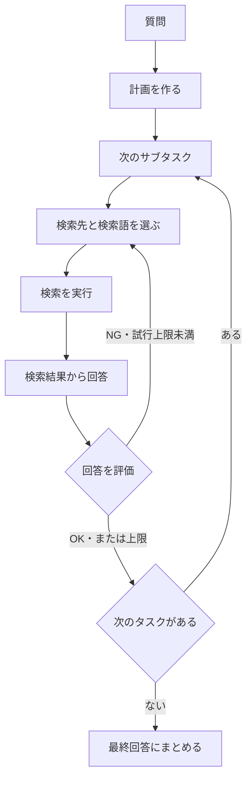

# コードの読み方

最初は `src/agent.py` の2つのグラフを読み、次に `src/steps.py` の各処理を確認します。画面や通信の細部を追わなくても、検索・回答・評価の流れを説明できる構成です。

## 1. 全体の流れはagent.py

[agent.py](../src/agent.py) の `create_graph()` が全体、`_create_subgraph()` が1サブタスクの処理です。

評価NGで上限に達したサブタスクには「回答が見つからなかった」と記録し、次へ進みます。通信・応答形式・トークン上限などの例外は実行全体を停止し、エラーとして保存します。

## 2. 各処理の中身はsteps.py

[steps.py](../src/steps.py) の各関数は、現在の状態を受け取り、更新する項目だけを返します。

| 関数 | 入力から何を作るか |
|---|---|
| `create_plan()` | 質問 → サブタスクのリスト |
| `select_tools()` | サブタスク、再試行時の助言 → 検索ツールと検索語 |
| `execute_tools()` | 検証済みの検索指示 → 出典付き検索結果 |
| `create_subtask_answer()` | 今回の検索結果 → サブタスクの回答 |
| `reflect_subtask()` | 回答と根拠 → 完了判定と再検索の助言 |
| `create_answer()` | 各タスクの回答 → 元の質問への最終回答 |

同じ `LLM` インスタンスを全段階で使います。用途に応じて渡すメッセージを作り直します。再検索時は前回の検索語と評価の助言を渡し、過去のツールメッセージを際限なく積みません。言語モデルを役割別に追加ロードする処理はありません。

`validate_calls()` は、すべての検索指示を検証してから実行するための境界です。許可していないツール名、重複ID、不正な引数をここで拒否します。`_select_native()` と `_select_json()` が互換モードの違いを受け持ち、グラフの分岐には混ぜていません。

## 3. 起動と後片付けはservice.py

[service.py](service.py) の `execute()` はGUIとCLIが共通で呼びます。

1. 同時実行を防ぎ、設定とロード済みモデルを確認する。
2. `RunLog` を開き、検索とエージェントを用意する。
3. 実行結果、またはエラーを保存する。
4. `ExitStack` に登録したLLM・Embeddingの通信クライアントを閉じる。

`with` を抜けると、成功・失敗にかかわらずクライアントとログハンドラーを片付けます。起動前の入力・モデル状態チェックで停止した場合は実行ログの作成前です。その場合は画面やCLIのエラー表示を確認します。

## 4. 保存と通信はそれぞれの担当へ

| ファイル | 受け持つこと |
|---|---|
| [run_log.py](run_log.py) | 1回の実行ログ、設定・回数・所要時間、結果JSON、失敗位置、本文保存の切り替え |
| [llm.py](../src/llm.py) | LM Studio／OpenRouterへの生成リクエスト、構造化出力、無料モデル制限、回数上限 |
| [search.py](search.py) | 書籍資料の確認、インデックス生成、TF-IDF／Embedding検索 |
| [embeddings.py](embeddings.py) | ローカルEmbedding API、プレフィックス、ベクトル正規化 |
| [checks.py](checks.py) | モデル一覧、ロード状態、接続・ツール・構造化出力の事前確認 |
| [models.py](../src/models.py) | 計画・検索結果・評価・最終結果の型と、グラフが受け渡す状態 |
| [security.py](../src/security.py) | 接続先、入力サイズ、秘密値、ファイル操作の境界 |
| [custom_logger.py](../src/custom_logger.py) | 起動時のコンソールログ設定。import時は既存ログ設定を変更しない |

GUIの [gui.py](gui.py) は入力・バックグラウンド実行・結果表示を担当します。エージェントの判断手順は `service.execute()` の先にあります。画面で入力した設定は [configs.py](../src/configs.py) の `Settings` にまとめて渡します。

## 5. ログから失敗を追う

`workshop/logs` の同じ日時のJSONとlogを開きます。詳細保存は初期オンです。

- JSON：質問、計画、各タスクの検索結果・評価、回答、実行設定、呼び出し回数。
- log：`QUESTION` → `DETAIL PLAN` → `DETAIL TOOL_SELECTION` → `DETAIL SEARCH` → `DETAIL SUBTASK_ANSWER` → `DETAIL REFLECTION` → `DETAIL FINAL_ANSWER`。
- 再試行：`REFLECTION` の `attempt` が増え、検索へ戻る。
- 例外：`error_type` と `error_location` で種類と発生ファイル・行を確認する。

APIキーはマスキングします。質問や検索結果そのものは残るため、共有前に内容を確認してください。

## 勉強会での説明順（約8分）

1. `agent.py` の2つのグラフで全体の流れを説明する。
2. `steps.py` の `create_subtask_answer()` で、検索結果をLLMへ渡す箇所を見る。
3. `reflect_subtask()` と `_after_evaluation()` で、評価と再試行の役割を分けて見る。
4. 実行ログで計画・検索・評価・回答を照合する。

検索方式だけ変えるなら検索ファイル、プロンプトを変えるなら `prompts.py` と `steps.py`、実行順序を変えるなら `agent.py` を読みます。既存の動作確認は `python -m unittest discover -s workshop -p "test_*.py"` で行います。
